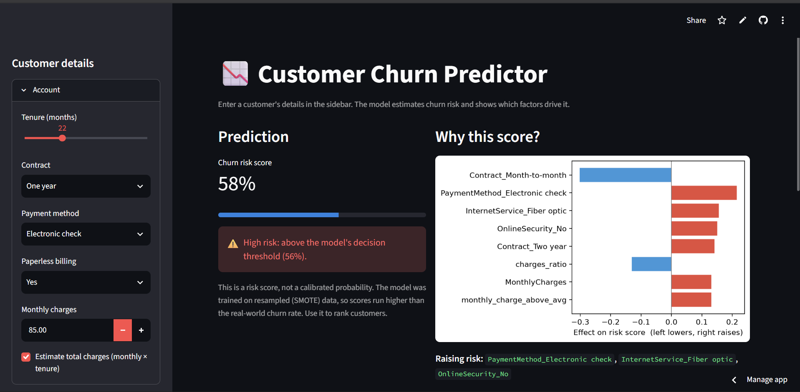

# Customer Churn Prediction

**Live demo:** https://customer-churn-prediction-dhhpd8ezdjw2hwjl9qtget.streamlit.app/

An end-to-end machine learning project that predicts which telecom customers are likely to churn, explains *why*, and serves the model in a web app.



## Problem
Keeping a customer is cheaper than winning a new one, but a retention team cannot contact everyone. The goal is to **rank customers by churn risk** so the team can focus on the right people first, and to say what is driving each customer's risk.

## Dataset
Telco Customer Churn (Kaggle): 7,043 customers, 19 raw features, about 27% churned (an imbalanced target).

## Approach
1. **Cleaning:** `TotalCharges` was stored as text with hidden blank strings that a normal null check misses. All affected rows were brand-new customers (tenure 0), so they were set to 0 instead of being imputed.
2. **EDA:** month-to-month contracts churn at about 43% versus 3% for two-year contracts. Churned customers averaged 18 months of tenure versus 38 for retained customers.
3. **Feature engineering:** tenure bands, a charge ratio, and an interaction flag for new month-to-month customers, justified by the EDA findings.
4. **Class imbalance:** SMOTE applied *inside* the cross-validation pipeline (training folds only) plus class weights. Models are judged with F1, ROC-AUC and precision-recall curves rather than accuracy.
5. **Modelling:** Logistic Regression, Random Forest and XGBoost compared with stratified 5-fold cross-validation; the best model was tuned with RandomizedSearchCV.
6. **Decision threshold:** chosen on out-of-fold training predictions, so the test set was used only for final reporting.
7. **Explainability:** SHAP for global drivers and per-customer explanations.
8. **Deployment:** Streamlit app. Feature code lives in one module shared by the notebook and the app, to prevent training-serving skew.

## Results
| Metric | Value |
|---|---|
| Final model | Logistic Regression (tuned) |
| CV ROC-AUC before tuning (5-fold, train only) | 0.849 |
| CV ROC-AUC after tuning | 0.850 |
| Test ROC-AUC | 0.847 |
| Test precision / recall / F1 at threshold 0.56 | 0.56 / 0.74 / 0.64 |

Top drivers of predicted churn (mean absolute SHAP): `Contract_Month-to-month, tenure, charges_ratio, MonthlyCharges, monthly_charge_above_avg`.

## Limitations and next steps
- Scores are **not calibrated probabilities** (SMOTE and class weights inflate them). The app labels them "risk score". Next step: probability calibration.
- The threshold maximises F1, not business value. A cost-based threshold (retention offer cost versus customer value) would be better.
- One static dataset with a random split: no time-based validation or external test data.
- Some engineered features overlap with existing ones; a feature-pruning pass would simplify the model.
- SHAP explains the model, not causal effects. Retention actions should be validated with an A/B test.

## Project structure
```
app.py                 Streamlit app
features.py            Feature engineering shared by notebook and app
churn_model.joblib     Trained scikit-learn / imbalanced-learn pipeline
model_config.json      Decision threshold, column list, library versions
shap_background.npy    Small data sample used for explanations
requirements.txt       Pinned dependencies
notebooks/             Full analysis notebook
assets/                Screenshots
```

## Run locally
```
pip install -r requirements.txt
streamlit run app.py
```
To retrain, open the notebook in Google Colab and upload the Kaggle CSV to `/content`.

## Tech stack
Python, pandas, NumPy, scikit-learn, imbalanced-learn, XGBoost, SHAP, Matplotlib, Streamlit.
